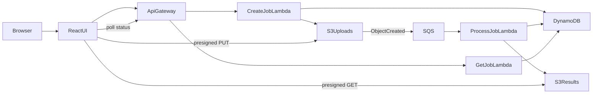

# Design and Implementation of a Serverless Cloud-Based PDF Processing Platform

## Objective

The platform lets a user merge, split, compress, convert, rotate, organize, and password-protect PDF files without running a permanent server. Each request is a short-lived job. Storage, the API, and the worker are managed AWS services, and the worker runs only when an upload event arrives.

The product name in the interface is cloudPDF. The same processing code runs in AWS Lambda. The web UI follows the familiar layout of consumer PDF sites such as iLovePDF: a white page, red accent actions, and a grid of tool cards.

## Architecture

A job moves through four states: `UPLOADING`, `PROCESSING`, `DONE`, or `FAILED`.

1. The browser sends the operation, file names, content types, and options to `POST /jobs`. The password, when there is one, is kept on the job item and is not returned to the browser.
2. API Gateway invokes the create function. That function writes the job to DynamoDB and returns a presigned S3 URL for each file.
3. The browser uploads the bytes directly to S3. The file body never passes through the API.
4. Each new object under `uploads/` sends a message to SQS.
5. The worker checks that every expected object is present. Early messages, from the first files of a multi-file job, are ignored. The message for the last file finds a complete set.
6. The worker claims the job with a conditional DynamoDB update, runs the operation, writes the result to the results bucket, and marks the job `DONE`.
7. The browser polls `GET /jobs/{jobId}` and receives a short-lived download URL.

The local server follows the same HTTP contract. It stores files on disk and starts a background thread in place of SQS, so the interface can be shown without an AWS account.

## AWS services

- **Amazon API Gateway HTTP API** exposes the two routes. It is cheaper and simpler than a REST API for a JSON create call and a JSON status call.
- **AWS Lambda** runs the create function, the status function, and the worker. The account is billed only while a function is running. The worker is capped at five concurrent executions so a class demo cannot fan out without limit. It has 1024 MB of memory and a 120 second timeout, which is enough for the 20 MB and 40 page limits.
- **Amazon S3** holds uploads and results in two private buckets. Public access is blocked and objects are encrypted with SSE-S3. A lifecycle rule deletes them after one day.
- **Amazon SQS** decouples the upload from the CPU work. The visibility timeout is 180 seconds, just longer than the worker timeout, so a crashed attempt becomes visible again quickly instead of waiting for the queue default. After three failed receives the message goes to a dead-letter queue.
- **Amazon DynamoDB** stores job status. The partition key is the job id. A TTL attribute removes the row after one day. On-demand billing fits a workload that is idle most of the time.
- **IAM** gives each function its own role. Create can write job rows and sign uploads. Status can read rows and sign downloads. The worker can read uploads, write results, and update the job. None of them can list every object in the account.
- **Poppler layer.** PDF-to-image conversion needs the `pdftoppm` binary. The SAM template builds a Lambda layer from Poppler inside the Amazon Linux build image. Merge, split, compress, organize, protect, and images-to-PDF do not need that binary.

CloudFront is not part of the template. For the demo, the React dev server calls the API URL. A static host can be added later and the `CorsOrigin` parameter set to that origin.

## Features and how they are implemented

The processors live in `backend/src/processors` and are covered by unit tests that build small PDFs in memory.

- **Merge** appends pages with `pypdf` in the order the client uploaded the files. The local end-to-end test uploads two PDFs and checks the page widths of the result, which proves both the order and the page count.
- **Split** parses a 1-based range such as `1-3,5` and copies those pages into one PDF. The other mode writes one PDF per page into a ZIP. Reversed ranges, repeated pages, and pages past the end of the document are rejected.
- **Compress** opens the file with `pikepdf`, replaces embedded images with JPEG streams at the chosen quality, and rewrites Flate streams. A test with an uncompressed image checks that the output is less than half the input size. A text-only page has little to remove, so the file may stay about the same size.
- **PDF to images** uses Poppler through `pdf2image` at 110 DPI and returns a ZIP of PNG or JPEG files. **Images to PDF** places each PNG, JPEG, or WebP image on its own page with Pillow, in upload order.
- **Rotate and organize** receives the final page list from the browser. Each entry is an original page index and a rotation of 0, 90, 180, or 270 degrees. Pages left out of the list are dropped. The thumbnails are drawn in the browser with PDF.js and are not uploaded.
- **Protect** saves the PDF with `pikepdf` encryption revision 6, which is AES-256. The user password and the owner password are the same value, so the file cannot be opened without it. A test checks that opening without the password fails and opening with it succeeds.

Encrypted inputs are rejected with a clear message. The user can protect a file, but this version does not unlock one.

## Security

- Buckets block public ACLs and public policies. The only way to read or write an object is a presigned URL that expires in 15 minutes for upload and 10 minutes for download.
- The presigned upload URL is bound to the content type agreed at job creation.
- Job ids are random UUIDs. There is no list-jobs route. Anyone who has the id can poll that job, which is acceptable for an anonymous demo and is why the download should not be shared.
- The protect password is written to DynamoDB only so the worker can read it when the S3 event arrives. It is not returned by the API, not written to CloudWatch by the application, and removed when the job succeeds or when the file is rejected. The local API test checks both the create response and the finished job file. If the worker crashes, the password can remain until the one-day TTL so a retry can still encrypt the file.
- Logs record the job id, the operation name, and the output size. They do not record file bytes or the password.
- Upload size is checked again in the worker, so a client cannot bypass the 20 MB limit by calling S3 directly with a URL that was issued for a normal job. The presigned URL itself does not embed a content-length policy. The worker refuses oversized objects and marks the job failed.

## Scaling and event-driven behaviour

Nothing in the request path stays running between jobs. API Gateway and Lambda scale with the number of calls. S3 absorbs the upload bandwidth. SQS buffers bursts: if five workers are already busy, further messages wait on the queue instead of failing the upload. DynamoDB on-demand scales the status reads from browsers that poll once a second.

The design avoids a common multi-file race. Two objects can arrive together and produce two queue messages. Both workers may see a complete set of files, but only one conditional update can change the status from `UPLOADING` to `PROCESSING`. The other worker leaves the job alone. If a worker dies after claiming the job, a later delivery can reclaim it once the claim is older than 150 seconds.

Failed user input, such as a bad page range, is marked `FAILED` and is not retried. Unexpected errors are retried up to three times and then land on the dead-letter queue.

## Limits

- 20 MB per file, 40 pages, 10 PDFs for a merge, and 20 images for images-to-PDF.
- Compression only shrinks images that `pikepdf` can decode. Some proprietary image encodings are left as they are, and the rest of the file is still rewritten.
- PDF-to-image needs the Poppler layer. The other tools still run if that layer failed to build.
- There are no user accounts. A job id is the access token for that job.
- The worker does not preserve interactive form features beyond what `pypdf` and `pikepdf` keep during a rewrite. For this course project the page content, order, rotation, and encryption are the required behaviour.

## Local verification

Unit tests cover every operation. A local API test creates a merge job, uploads two generated PDFs, waits until the status is `DONE`, and checks that the downloaded PDF has the expected pages in order. The same test suite checks that a protect password is absent from the create response and from the stored job after success.
